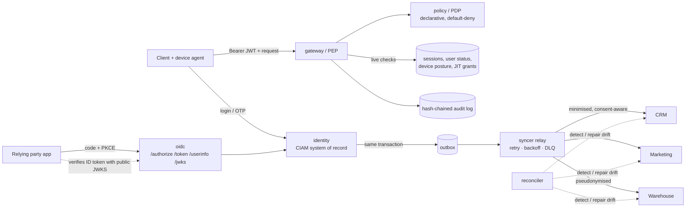

# gatekeep — Customer Identity, Zero-Trust Access, and Identity Data Sync (Go)

A compact, runnable reference implementation of three things that normally live in separate teams:

1. **CIAM** — registration, login, TOTP MFA, rotating refresh tokens, consent, right-to-erasure, and an **OpenID Connect provider** (Authorization Code + PKCE, RS256 ID tokens, JWKS, discovery).
2. **Zero trust** — a policy enforcement point that re-evaluates *identity + session + device posture + context* on **every** request, default-deny.
3. **Data synchronisation** — a transactional-outbox pipeline that keeps CRM, marketing, and analytics systems consistent with the identity system of record, honouring consent and privacy.

Go standard library only: **no third-party dependencies, no `go.sum`.**

## Getting started

Open the folder in the dev container (`.devcontainer/devcontainer.json`, Go 1.23), or use any Go 1.23+ toolchain.

```bash
go test -race ./...        # unit + HTTP end-to-end tests
go run ./cmd/demo          # identity + zero trust + sync scenario
go run ./cmd/oidc-demo     # OIDC flow as a relying party, plus attack replays
go run ./cmd/server        # HTTP API on 127.0.0.1:8080
```

The module path is `github.com/brandonrubio/gatekeep`.

## Layout

Standard Go project layout: executables in `cmd/`, all application code in `internal/` (not importable by other modules).

```
cmd/
  server/        HTTP server entrypoint
  demo/          narrated identity / zero-trust / sync walkthrough
  oidc-demo/     relying-party walkthrough + attack replays
internal/
  identity/      CIAM service: auth, MFA, sessions, refresh rotation, consent, erasure, risk, outbox writes
  oidc/          OIDC provider: authorize, token, userinfo, discovery, JWKS, key rotation
  gateway/       policy enforcement point (PEP)
  policy/        policy decision point (PDP): declarative, default-deny
  device/        device enrolment + HMAC-signed posture reports
  syncer/        outbox relay, idempotent targets, transforms, DLQ, reconciliation
  audit/         tamper-evident, hash-chained audit log
  cryptoutil/    PBKDF2, HS256/RS256 JWT + JWKS, RFC 6238 TOTP, pseudonymisation
  store/         in-memory system of record (stands in for Postgres)
  httpapi/       HTTP edge (routing, request parsing, status mapping)
  app/           dependency wiring
  clock/         injectable clock for deterministic expiry/backoff tests
  fixture/       helpers shared by tests and demos
```

## Architecture



## Zero-trust principles → where they're enforced

| Principle | Implementation |
|---|---|
| Never trust, always verify | `gateway` re-checks token, **live session**, **user status**, device posture, and policy on every call. A valid, unexpired JWT is still refused after suspension or session revocation. |
| Least privilege | Per-resource rules in `policy` (role, ownership, assurance level, device class, network). Support staff need a **time-boxed, reason-bound JIT grant**. |
| Assume breach | 5-minute access tokens; refresh-token rotation with **reuse detection** that burns the whole session. |
| Verify the device | Posture reports are HMAC-signed with a per-device key; forged or stale (>1h) posture is rejected. Posture changes take effect immediately, with no re-login. |
| Context-aware | Session-to-network binding: replaying a token from a new network adds risk and blocks high-sensitivity resources. |
| Step-up, not lock-out | Policy returns `allow` / `deny` / `step_up`; OTP step-up raises the session's assurance level. |
| Explicit, auditable | Every decision (including denials of garbage tokens) is written to a hash-chained log; `Verify()` pinpoints tampering. |

## OpenID Connect provider

Authorization Code flow with **mandatory PKCE**, following the OAuth 2.0 Security BCP / OAuth 2.1 direction. A relying party needs only the issuer URL: it discovers endpoints, then verifies ID tokens against the **public JWKS** (RS256 via `crypto/rsa`), so it never holds a secret.

| Control | Behaviour |
|---|---|
| PKCE | `S256` required; `plain`, missing challenge, and implicit flow (`response_type=token`) are refused |
| Redirect URIs | Exact string match. A bad client/URI returns an error page and **never redirects** (no open redirect) |
| Authorization codes | 256-bit, stored hashed, single use, 60 s TTL, bound to client + redirect URI + challenge |
| Code replay | Treated as theft: the session behind the code is revoked, so already-issued tokens die at the gateway |
| Failed PKCE | Does not consume the code, so an attacker without the verifier can't burn the user's login |
| ID tokens | RS256, `kid` header, `nonce`, `at_hash`, `auth_time`, `acr`/`amr`; claims limited by granted scope |
| Step-up hooks | `max_age` forces fresh authentication; `acr_values=2` demands an MFA-backed session |
| Key rotation | A new signing key is added to the JWKS while old public keys keep verifying in-flight tokens |
| Zero trust | `/userinfo` runs through the same gateway/PDP, so a suspended user or revoked session is refused even with a valid token |

## Sync design decisions

- **Transactional outbox** — the state change and its event are written together, so there's no dual-write gap between "user updated" and "event published".
- **Thin events, state read at delivery** — events hold only `(aggregate, type, version)`. The relay reads the *current* snapshot when delivering, so a deleted user's PII can never be replayed from a queue or DLQ.
- **At-least-once + idempotent consumers** — targets dedupe by event ID and apply only newer aggregate versions, so duplicates and out-of-order delivery converge.
- **Per-target failure isolation** — a CRM outage doesn't block marketing. Exponential backoff → dead-letter queue → operator replay.
- **Privacy by construction** — marketing only holds users with consent (withdrawal removes them); the warehouse gets HMAC pseudonyms and no email/name; erasure leaves a PII-free tombstone so late events can't resurrect a record.
- **Reconciliation** — compares each target to what the source *should* contain and reports `missing / stale / unexpected / orphaned`, with optional repair. This catches lost writes, silent corruption, and backup-restore resurrections that event streams alone can't.

## Threat model (covered by tests)

| Threat | Mitigation |
|---|---|
| Credential stuffing / brute force | Lockout, risk scoring, constant-time verify, no user enumeration |
| OTP replay | Counter high-water mark per user |
| JWT `alg=none`, tampering, HS/RS key confusion | Algorithm pinning, signature, `iss`/`aud`/`exp` checks |
| Stolen refresh token | Rotation + reuse detection → session revoked |
| Intercepted authorization code | PKCE, single-use codes, replay revokes the session |
| Compromised/unpatched device | Posture-gated resources, fresh signed attestations only |
| Insider/support over-reach | JIT grants with expiry and reason; every use audited |
| Audit log tampering | Hash chain verification |
| Stale or leaked PII downstream | Consent-aware transforms, erasure tombstones, reconciliation |

## Known limitations (what I'd change for production)

- `internal/store` is an in-memory stand-in for a database. Services are not goroutine-safe on their own; `httpapi` serialises requests with one mutex, which plays the role of a transaction boundary. Production: Postgres, with the outbox written in the same DB transaction and a relay using `SELECT … FOR UPDATE SKIP LOCKED` or a Debezium/Kafka CDC consumer.
- Internal API access tokens use HS256 with a single shared key; production should use asymmetric signing everywhere, keys in a KMS/HSM, and PBKDF2 replaced or complemented by argon2id.
- Posture attestation is simulated with per-device HMAC; real deployments use MDM/EDR signals or TPM-backed certificates and **mTLS**.
- Sync targets are in-memory fakes; real connectors need rate-limit handling and per-system schemas.
- `/authorize` identifies the user from an existing session bearer token; a real deployment renders a login page and uses a session cookie. Only public clients (PKCE) are supported: no client secrets, consent screen, or dynamic registration.
- Not implemented: WebAuthn/passkeys, RP-initiated/back-channel logout, token introspection/revocation endpoints.
- `X-Client-IP` is trusted so demos can simulate networks; take the client IP from a trusted proxy only.

## Legacy

`legacy/python/` is the original Python implementation (57 passing tests). It is kept only as a reference until the Go port is verified; delete it afterwards.
